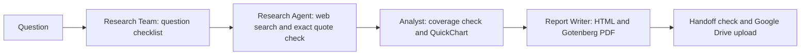
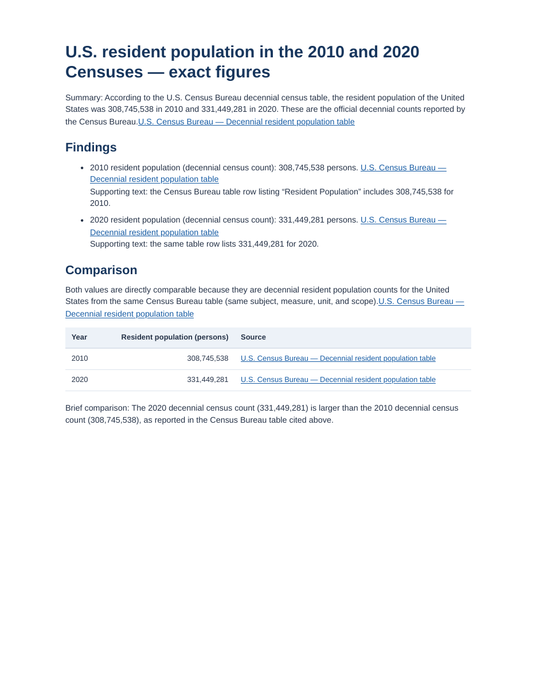
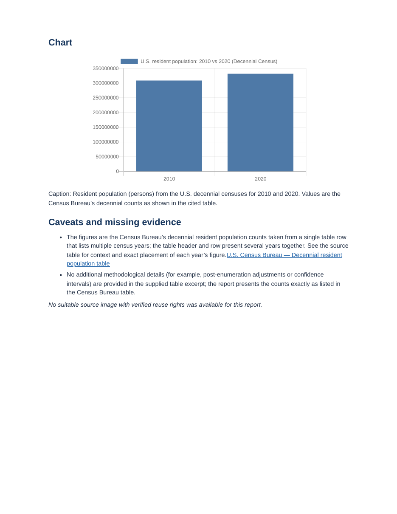

# Multi-Agent Research & Report Automation

**Overview:** An automated multi-agent research pipeline built in **n8n** that turns a research question into a verified, cited PDF report with comparison charts—while automatically checking quotations against source pages and flagging any missing data instead of guessing.

Built across four modular n8n workflows: **Research Team (Orchestrator)**, **Research Agent**, **Analyst**, and **Report Writer**.

## How the Four Workflows Work

1. **[Research Team (`workflows/research-team.json`)](workflows/research-team.json)** — Converts the incoming research prompt into a structured checklist of required facts, orchestrates the three specialist sub-workflows in sequence, validates handoffs and citation links, and uploads the final PDF report to Google Drive.
2. **[Research Agent (`workflows/research-agent.json`)](workflows/research-agent.json)** — Searches and extracts web sources via Tavily, then runs deterministic JavaScript checks to verify that every quotation appears verbatim on its cited source page. Includes a bounded follow-up verifier if any checklist item is still uncovered.
3. **[Analyst (`workflows/analyst.json`)](workflows/analyst.json)** — Evaluates whether the verified passages answer each checklist requirement and generates a QuickChart comparison bar chart when the extracted metrics support a direct comparison.
4. **[Report Writer (`workflows/report-writer.json`)](workflows/report-writer.json)** — Compiles the verified findings, source links, and chart into a styled HTML document, renders it to PDF via Gotenberg, and clearly marks any unavailable data points.

Each workflow canvas includes plain-English sticky notes documenting the role of every stage and validation node.

## Benchmark Run & Sample Output

On a benchmark comparison of the 2010 and 2020 United States Census resident population counts:

- The **Research Team** pipeline completed end-to-end in **1 minute 27 seconds** and uploaded the finished report to Google Drive.
- The generated [two-page sample PDF](demo/Research-Team-Census-Demo.pdf) cites the official [U.S. Census table](https://www.census.gov/data/tables/time-series/dec/popchange-data-text.html), reports **308,745,538** (2010) and **331,449,281** (2020), and includes a structured comparison table and bar chart.
- In negative-path testing where required source figures were absent, the pipeline halted chart generation and explicitly flagged the missing evidence rather than hallucinating numbers.

### Sample Report Preview

| Page 1 | Page 2 |
| --- | --- |
|  |  |

## Setup & Configuration

The JSON files in [`workflows/`](workflows/) are sanitized exports with credential IDs and private instance links removed. To run the pipeline in your own n8n instance:

1. Import all four workflow files from [`workflows/`](workflows/).
2. Connect your **OpenRouter**, **Tavily**, and **Google Drive** credentials.
3. Update the `Execute Sub-workflow` nodes in `research-team.json` to reference your imported sub-workflow IDs and connect a Gotenberg container for HTML-to-PDF rendering.
