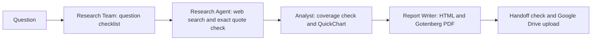
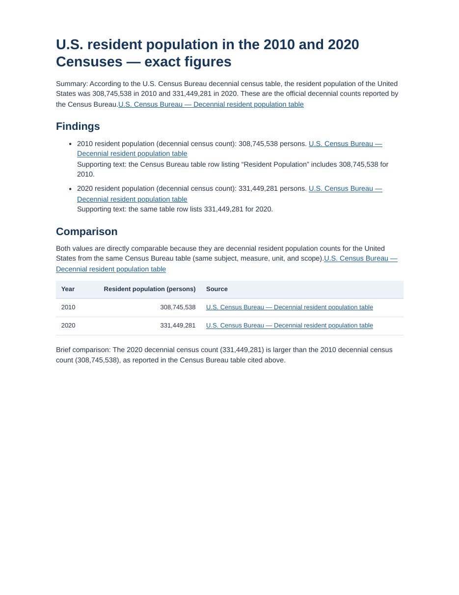
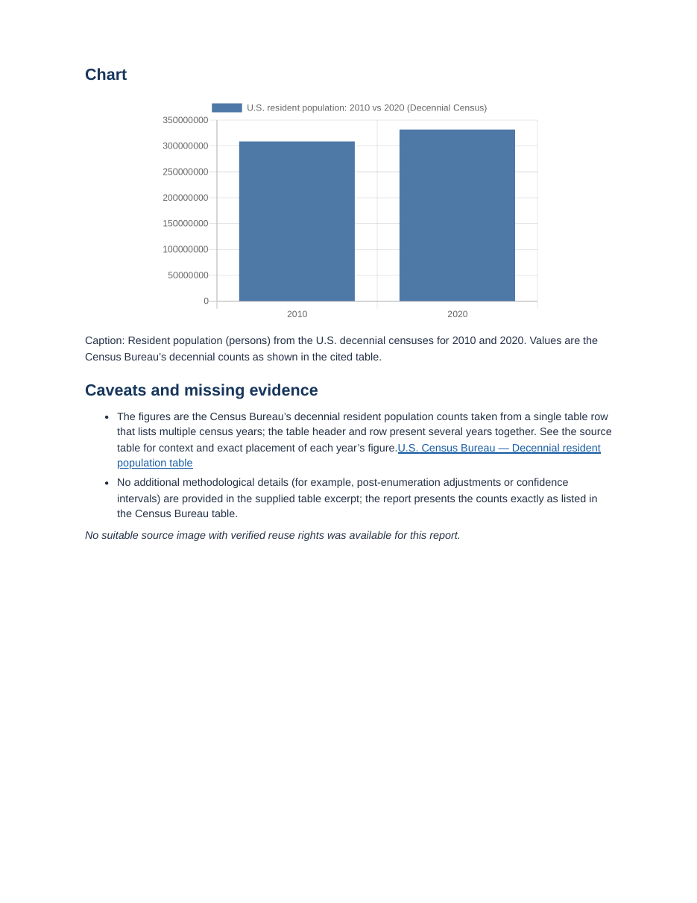

# Research and report automation

**Goal:** Turn a research question into a cited PDF report with a comparison chart, while clearly flagging any missing evidence instead of guessing.

This is a personal n8n project built around four workflows: **Research Team**, **Research Agent**, **Analyst**, and **Report Writer**.

## How the four workflows work

1. **Research Team** ([workflows/research-team.json](workflows/research-team.json)) turns the incoming question into a short checklist of required factual answers, calls the three specialist workflows once each in order, checks the final handoffs, and uploads the finished PDF to Google Drive.
2. **Research Agent** ([workflows/research-agent.json](workflows/research-agent.json)) searches and extracts source pages with Tavily, then runs a code check to confirm that each quotation actually appears on its cited page. If required items are still missing, a bounded verifier runs one targeted follow-up check.
3. **Analyst** ([workflows/analyst.json](workflows/analyst.json)) checks whether the verified quotes answer each checklist item and builds a QuickChart bar chart only when the numbers support a direct comparison.
4. **Report Writer** ([workflows/report-writer.json](workflows/report-writer.json)) formats the report into clean HTML, converts it to a PDF through Gotenberg, and labels any missing items as incomplete.

Each workflow canvas also includes plain-English sticky notes explaining what its code nodes do.

## Demonstrated result

On a controlled test question comparing the 2010 and 2020 United States resident population counts:

- The main **Research Team** workflow completed in **1 minute 27 seconds** (calling Research Agent, Analyst, and Report Writer once each) and uploaded the finished PDF to Google Drive.
- The generated [two-page sample PDF](demo/Research-Team-Census-Demo.pdf) cites the official [U.S. Census table](https://www.census.gov/data/tables/time-series/dec/popchange-data-text.html), reports **308,745,538** for 2010 and **331,449,281** for 2020, and includes a comparison table and bar chart.
- In a separate partial-evidence run where the 2010 figure was missing, the workflow marked the report as incomplete and skipped the chart instead of filling in unsupported numbers.

### Sample report preview

| Page 1 | Page 2 |
| --- | --- |
|  |  |

## Using the workflow files and honest limits

The JSON files in [workflows/](workflows/) are sanitized exports from the working October 2026 n8n setup, with credential IDs and private workflow links removed. To run them in your own n8n setup, import all four files, connect your own OpenRouter, Tavily, and Google Drive credentials, point the subworkflow nodes to your new workflow IDs, and connect a local Gotenberg container.

This repository shows a working portfolio demonstration on a controlled question, not a guarantee of accuracy or predictable token cost across every topic. Always review a generated PDF against its linked sources before sharing it.
