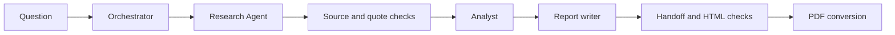

# Research and report automation

**Question.** Can a workflow collect web evidence, assess it, and generate a PDF report while making unsupported or conflicting claims easier to catch?

This is a personal n8n project using an orchestrator and specialist research, analysis, and report-writing workflows. The project summary reports working chart and no-chart PDF paths. An AI-assisted revision of four local workflow exports also includes stricter evidence gates; its checks were **local mocked tests**, not a live service validation.

## What is documented

- [Sanitized workflow exports](workflows/) contain the orchestrator, research, analyst, and writer workflows. Credential references, original workflow IDs, pinned data, instance metadata, and webhook IDs were removed before publication. These exports have not been imported or run after sanitization.
- The [architecture and limits](RELIABILITY.md) note explains quote verification, numeric checks, chart rules, and the checks that still require human judgment.
- [Validation results](Validation-results.json) record **37 local mocked checks passed, 0 failed** for the revised exports **before public sanitization**. They did not execute n8n, live research APIs, or PDF conversion, and they do not validate the sanitized copies.
- The original project summary recorded a case where two proposed quotations were rejected in a mountain-height test. That issue and the later revision should not be conflated with a full end-to-end production test.

## Reproduction and limits

Import the four sanitized JSON files as inactive workflows, then reselect your own credentials, remap the four workflow references, and configure a reachable Gotenberg endpoint. Confirm the community Tavily node and n8n node versions are compatible before a manual run. The exports were structurally checked for secret-like literals and removed credential fields, but **a live import/run is still needed**. Do not use the local validation count as a reliability or factual-accuracy percentage.

Review a generated report against its cited source passages, units, years, scope, and actual PDF layout before sharing it. A matched quote alone does not prove that a conclusion follows from the source.
